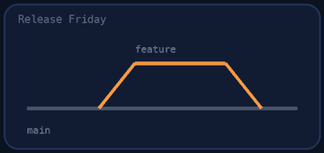
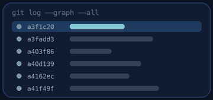

<p align="center"></p>

| | |
|-|-|
| **Time** | 60-75 min |
| **Cost** | free |
| **You need** | Git in your Ubuntu environment |

## How this lab works

1. **Fork** this repository to your own GitHub account (button at the top right).
2. Clone **your fork** in your Ubuntu environment (WSL on Windows, your OrbStack machine on Mac).
3. Read the lab below (the same text is in [`LAB.md`](LAB.md)) and follow the mission.
4. Answer the questions in [`SUBMISSION.md`](SUBMISSION.md). Where a question asks for output, paste it in a code block. No screenshots needed.
5. Commit and push. Open the **Actions** tab of your fork (click *I understand my workflows, go ahead and enable them* the first time). The **Lab check** shows what is still missing.
6. When the check is green, **submit the URL of your fork** in the course platform.

> [!NOTE]
> The check only looks at your answers and any files the lab asks you to commit. Your instructor reads your work and may ask you to explain any line.

<p align="center"></p>

## 🎬 The situation

<p align="center"></p>

Clipstr has three developers and one shared repository. Maya (lead) just handed you the keys: *"This week you ship Clipstr 1.1.0. We use Git Flow: `develop` for work in progress, `main` for what customers run, feature, release and hotfix branches in between. Priya and Tomas keep pushing while you work. Do not lose their work, and do not ship anything unfinished."*

Everything runs on your machine: a local `origin` plays the part of GitHub, and a script plays your teammates.

> [!IMPORTANT]
> **Your mission**
> - Build a feature on its own branch and keep up with a `develop` that keeps moving
> - Cut **release 1.1.0**, tag it, and merge it back
> - Survive a production bug: ship **hotfix 1.1.1** without shipping unfinished work
> - Understand the history you made, not just run the commands

**Time:** 60-75 min | **Cost:** free | **You need:** Git in your Ubuntu environment. Set your identity first if you never did: `git config --global user.name "Your Name"` and `git config --global user.email you@example.com`

<p align="center"></p>

## Part 0 - Set the scene

Fork this repository, clone your fork in your Ubuntu environment, then run:

```bash
./setup.sh
```

It builds a team repository in `~/git-lab`. Your working copy is `~/git-lab/clipstr`, and the shared remote is `~/git-lab/origin.git`. **Do all Git work in `~/git-lab/clipstr`.** Keep a second terminal in this lab repo for the helper scripts.

<p align="center"></p>

## Part 1 - Recon: read the history before you touch it

<p align="center"></p>

In `~/git-lab/clipstr`:

1. `git log --oneline --graph --all`. How many branches and tags exist? Who wrote what? (`git shortlog -sn --all`)
2. `git branch -a` and `git tag -n`. Which branch is the "customers run this" branch, which is the "work in progress" one?
3. Open `VERSION`. What version does `main` say it is?
4. What is the difference between `git log main` and `git log develop`? (`git log main..develop --oneline`)

> [!NOTE]
> **Think** Why does Git Flow keep two long-lived branches instead of one? What does `main` promise to everybody?

<p align="center"></p>

## Part 2 - A feature, while the world moves

1. Create `feature/qr-codes` **from `develop`**. Check where you are with `git status` and `git branch`.
2. Add a file `qr.py` with any small function, commit it. Make a **second** commit with a documentation line. Push the branch to `origin` with upstream tracking.
3. Now your teammate acts. In the lab repo terminal run:

```bash
./teammate.sh feature
```

> [!NOTE]
> **Predict** Priya just changed `develop` on the remote. You have not pulled. What does `git status` say? What does `git log --oneline --graph --all` look like after `git fetch`? Write down your prediction, then look.

4. Bring your branch up to date. You have two options, **rebase** onto `origin/develop` or **merge** `origin/develop` into your branch. Pick one, do it, and be able to say why. Look at the graph afterwards.
5. If you rebased, your branch history changed, so a normal push is rejected. Try `git push` and read the message. Then push safely with `--force-with-lease`.

> [!WARNING]
> **Break it** Read what `git push --force` would do compared with `--force-with-lease` (look it up). Imagine Priya had pushed to **your** feature branch an hour ago. What does each command do to her commit?

6. Merge the feature into `develop` using `--no-ff` and push `develop`.

> [!TIP]
> **Checkpoint** `git log --oneline --graph develop` shows a merge commit that groups your two commits, and Priya's "Add rate limiting" is still there.

<p align="center"></p>

## Part 3 - The release train: 1.1.0

1. Create `release/1.1.0` from `develop`. On a release branch you only polish: bump `VERSION` to `1.1.0` and commit.
2. Merge the release branch into `main` with `--no-ff` (message: `Release 1.1.0`).
3. Tag that commit with an **annotated** tag `v1.1.0` (`git tag -a`). Run `git show v1.1.0` and compare with `git show v1.0.0`. What extra information does an annotated tag carry?
4. Merge the release branch **back into `develop`** (the bump must not be lost), and push `main`, `develop` and the tags.

> [!NOTE]
> **Think** Why `--no-ff` for the release? What would `git log main` look like with a fast-forward instead?

<p align="center"></p>

## Part 4 - Saturday, 07:12: the incident

```bash
./teammate.sh bug
```

It prints the incident report and also has Tomas push an unfinished experiment into `develop`. Read both the report and `git log --oneline develop`.

> [!NOTE]
> **Predict** You need a fix in production **now**. Which branch do you start the fix from: `main` or `develop`? What goes wrong if you pick the other one?

1. Create `hotfix/1.1.1` from `main`. Fix `healthz()` in `app.py` so it does **not** always report `"ok"` (any reasonable change). Bump `VERSION` to `1.1.1` and commit.
2. Merge into `main` with `--no-ff`, tag `v1.1.1`, push.
3. **Now the step everybody forgets.** Before you do it, run `git log develop..main --no-merges --oneline`. What does it print, and what does that mean?
4. Merge the hotfix into `develop` too. **Expect a conflict**: Tomas's experiment and your fix touched the same end of `app.py`. Resolve it, keeping both, with the editor of your choice, then commit and push. Run the log command from step 3 again.

> [!WARNING]
> **Break it** Open `app.py` while the conflict is unresolved and read the `<<<<<<<`, `=======` and `>>>>>>>` markers. Explain what each side is. What would happen if you committed the file with the markers still in it?

<p align="center"></p>

## Part 5 - Prove it

<p align="center"></p>

```bash
./verify.sh
```

It inspects the shared `origin` and checks the shape of the history, not exact commands, so there is more than one correct way to get there. If something fails, read the line: it names what is missing.

<p align="center"></p>

## Level up (optional)

- **Undo safely.** On a scratch branch, make a bad commit and compare `git revert` with `git reset --hard`. When is each acceptable on a shared branch?
- **Squash.** Redo the feature as one commit with `git merge --squash`. What do you gain and lose in history?
- **Aliases.** Add a Git alias `lg` for the graph log you have typed ten times.

<!-- teardown:start (generated by labs.py, do not edit) -->
## Tear down (mandatory)

<p align="center"></p>

Resources left behind cost money, keep doors open and pollute the next lab. Removing what you created is part of the job, so it is part of the submission: **you must prove it is gone**.

Do this **last**, after you have pasted your `verify` output into `SUBMISSION.md` (once you tear down, the lab can no longer be verified).

1. Run `./teardown.sh`. It deletes `~/git-lab` (the fake origin and your working copy).
2. Make sure everything you want to keep is already committed in **this** repository.

Then run the proof:

```bash
./verify-teardown.sh
```

It prints a list of checks and must end with **TEARDOWN VERIFIED**. If it reports leftovers, remove them and run it again. Paste the full output in your submission.
<!-- teardown:end -->

<!-- submission:start (generated by labs.py, do not edit) -->
## 📬 Submission

Answer the questions in `SUBMISSION.md` in **your fork** (paste output in code blocks where asked), push, then submit the **URL of your fork**.

**Questions to answer**

1. Paste `git log --oneline --graph --all` of your finished repo. Point out one merge commit, one tag and the commit where Priya's work arrived while you were working.
2. When Priya pushed to `develop` while your feature was open, what did you do and why (rebase or merge)? What would `git push --force` have done to Priya's work, and why is `--force-with-lease` safer?
3. Why do release and hotfix branches have to be merged back into `develop`? Show what `git log develop..main` printed before and after you did it.
4. Explain the difference between a fast-forward merge and `--no-ff`. When did you want each one?
5. Paste the output of `./verify.sh`. It must end with **ALL CHECKS PASSED**.
6. **Tear down.** Paste the output of `./verify-teardown.sh`. It must end with **TEARDOWN VERIFIED**.
<!-- submission:end -->
